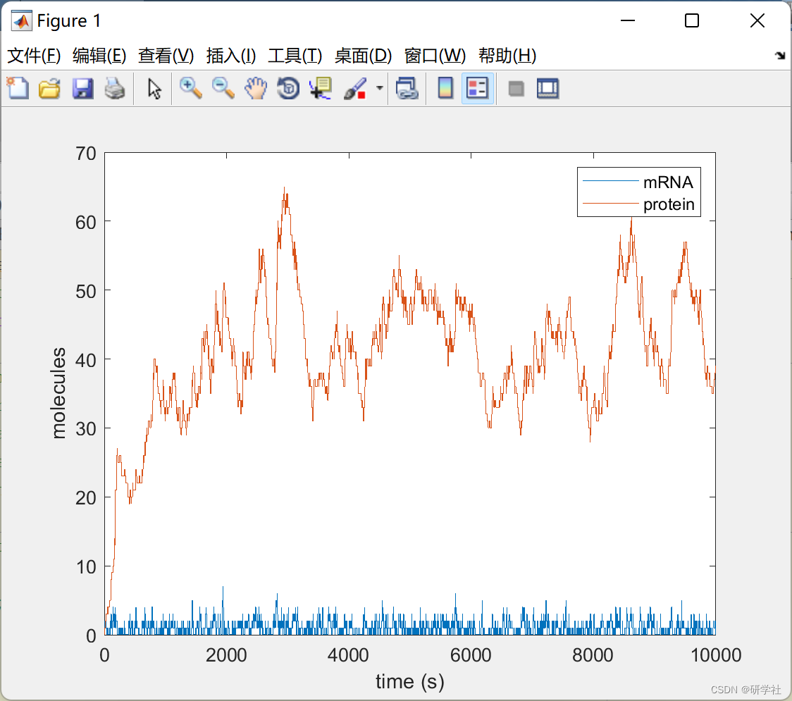

# Giresp Random Simulation Algorithm (SSA) (Matlab Code Implementation)

📚2 Running Results
Editing the results:
Part of the code:
%% Reaction network:  
% 1. transcription:   0  --kR--> mRNA  
% 2. translation:    mRNA  --kP--> mRNA + protein  
% 3. mRNA decay:     mRNA  --gR--> 0  
% 4. protein decay:   protein --gP--> 0  
%% Rate constants  
p.kR = 0.1;%0.01;  
p.kP = 0.1;%1;  
p.gR = 0.1;  
p.gP = 0.002;  
%% Initial state  
tspan = [0, 10000]; %seconds  
x0  = [0, 0];  %mRNA, protein  
%% Specify reaction network  
pfun = @propensities_2state;  
stoich_matrix = [ 1 0  %transcription  
0 1  %translation  
-1 0  %mRNA decay  
0 -1 ]; %protein decay  
%% Run simulation  
[t,x] = directMethod(stoich_matrix, pfun, tspan, x0, p);
%[t,x] = firstReactionMethod(stoich_matrix, pfun, tspan, x0, p);  
%% Plot time course  
figure();  
stairs(t,x); set(gca,'XLim',tspan);  
xlabel('time (s)');  
ylabel('molecules');  
legend({'mRNA','protein'});  
end  
function a = propensities_2state(x, p)  
% Return reaction propensities given current state x  
mRNA  = x(1);  
protein = x(2);  
a = [p.kR;      %transcription  
p.kP*mRNA;   %translation  
p.gR*mRNA;   %mRNA decay  
p.gP*protein]; %protein decay  
end  
🎉3 References
🌈4 Matlab code implementation

## Images

<!-- PAYMENT_BLOCK -->

## Get this dataset

- Payment link (Stripe): [Buy now](https://buy.stripe.com/3cs8yP7sY87d0vu9AB)
- Payment QR code: 

<!-- /PAYMENT_BLOCK -->
